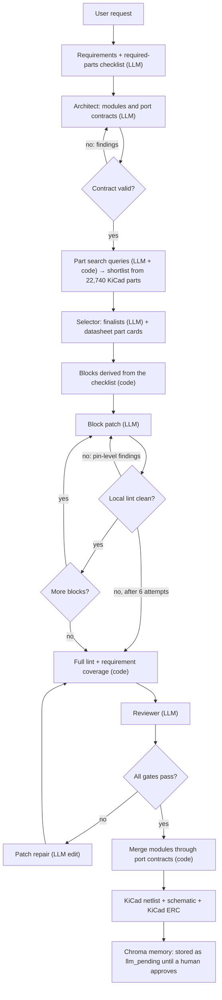

🇬🇧 English · 🇹🇷 [Türkçe](README.tr.md)

# PcbCreator

**A local-LLM, multi-agent system that designs small PCB schematics block by block, judged by a deterministic linter and by KiCad itself.**

The model never sees the whole problem at once: a requirement checklist is turned into functional blocks, each block is added as a small patch and checked immediately, and the result is drawn as a real KiCad schematic. Everything runs locally (a quantised 27B model on an 8 GB GPU). Goal of the project (TÜBİTAK 2209-A): LLM-designed sub-boards that are merged into larger boards such as a flight controller, with a first set of simple boards actually fabricated.


*Schematic of a 5 V → 3.3 V LDO board with a power LED, designed by the local model and drawn by KiCad (`assets/demo.png`). It passes our gates but is **not fabrication-ready**, see Selected results.*

## Summary

| Problem | Method | Hardware / tools | Paper |
|---|---|---|---|
| One-shot LLM schematic generation produces designs that look plausible but are electrically wrong or ignore the request | Stepwise block construction from a requirement checklist, part shortlist from 22,740 KiCad parts, datasheet part cards, local lint per block, patch-based repair, LLM reviewer, KiCad ERC | Ternary Bonsai 27B (PrismML llama.cpp fork) on an RTX 5060 8 GB, KiCad 10.0.7, Chroma | [`paper/yontem.pdf`](paper/yontem.pdf) (method report, Turkish) |

### System architecture


Orange boxes are LLM roles, blue boxes are deterministic code. Every LLM output passes a deterministic gate before it moves on, and LLM results are never reused as examples until a human approves them.

### Flow diagram (how it works)



## Selected results

All results are single runs of a non-deterministic local model on one development request (a 5 V → 3.3 V LDO board with a green LED and two 2-pin connectors). They show what the pipeline does, not a benchmark. A held-out test set is still TODO.

### Result 1: first LLM design that passed every gate
All four blocks (regulator, LED, two connectors) were accepted on the first attempt, the module passed the full lint, the requirement coverage check and the reviewer, and KiCad opens and renders it (`plots/sonuc_1.png`). Checking the part's datasheet by hand shows it is **still wrong in its values**: input and output capacitors are 100 nF, while the TI LP38693 datasheet asks for 1 µF (input) and a 1 µF ceramic minimum (output). The datasheet part card did not carry this requirement (only the first 12 datasheet pages were read), which is being fixed.


### Result 2: lint-clean and reviewer-approved, but wrong
An earlier design passed our linter and the LLM reviewer, yet both 2-pin connectors were wired VIN/VOUT with no ground pin. It was only obvious once drawn (`plots/sonuc_2.png`). It led to the rule E053 (a connector that carries a rail needs a ground pin). The same kind of escape happened with an LED wired directly across the rail (rule E051).


### Result 3: failure classes found in real runs and what catches them now

| Failure of the local model | Deterministic or structural countermeasure |
|---|---|
| Switching regulator chosen for a "low-dropout linear" request | Requirement coverage check by KiCad library family (E200) |
| LED wired across the rail, resistor in parallel | LED series-resistor rule (E051) |
| 2-pin connectors with no ground | Connector return-path rule (E053) |
| LED block built twice (resistor listed as its own requirement) | `support` kind: supporting passives get no block of their own |
| An LED added inside the regulator block, later blocks collide | Block scope rule (E205); a dirty block hands over to repair |
| Whole-module regeneration broke parts that already worked | Patch-based repair (remove / detach / add) |
| Wrong designs written to memory as "verified" (twice) | LLM results are stored as `llm_pending` and excluded from retrieval until approved |

*Figures are in `plots/`, the corresponding module files are in `results/`.*

## Installation

**Requirements:** Linux, Python 3.11–3.13 ([uv](https://docs.astral.sh/uv/) recommended), KiCad 10 with its symbol/footprint libraries (`/usr/share/kicad`), poppler-utils (`pdftotext`, `pdftoppm`), about 8 GB VRAM and 16 GB free RAM for the 27B model (not needed for the tests).

```bash
git clone https://github.com/GulogluHaktan/PcbCreator.git
cd PcbCreator
uv sync --extra dev            # or: python -m venv .venv && . .venv/bin/activate && pip install -r requirements.txt && pip install -e .
python scripts/check_install.py
uv run pytest                  # 60 tests, no model needed
```

**Local model (needed for `pcbc design`).** Ternary Bonsai 27B needs PrismML's llama.cpp fork (Ollama cannot load this format):

```bash
mkdir -p ~/llm/prism-llama ~/llm/models
gh release download prism-b10787-73bfe6c -R PrismML-Eng/llama.cpp \
   -p 'llama-prism-b10787-73bfe6c-bin-linux-cuda-13.3-x64.tar.gz' -D ~/llm/prism-llama
tar -xzf ~/llm/prism-llama/llama-prism-*.tar.gz -C ~/llm/prism-llama
curl -L -o ~/llm/models/Ternary-Bonsai-27B-PQ2_0.gguf \
   https://huggingface.co/prism-ml/Ternary-Bonsai-27B-gguf/resolve/main/Ternary-Bonsai-27B-PQ2_0.gguf
uv venv ~/llm/cudalibs --python 3.12 && uv pip install --python ~/llm/cudalibs/bin/python nvidia-cuda-runtime nvidia-cublas
```

## Usage

Without a model, you can lint, merge, export and draw designs:

```bash
uv run pcbc example --out examples                                  # hand-written regression design (not LLM output)
uv run pcbc lint examples/mcu.module.json [--strict]                # exit code 1 on errors
uv run pcbc merge examples/flight_controller.design.json -o fc.net  # merge modules, lint the board, KiCad netlist
uv run pcbc render results/ldo_board.module.json --out render       # real KiCad schematic + PDF + PNG + KiCad ERC
```

With the local model:

```bash
uv run pcbc index-kicad --memory .pcbc/chroma     # once: index all 22,740 KiCad parts (a few minutes)
uv run pcbc seed-blocks --memory .pcbc/chroma     # generic human-written block patterns (origin=human)
scripts/serve.sh                                  # llama-server on http://127.0.0.1:8080 (about 1 minute to load)
uv run pcbc design "Power board: input 5 V from a 2-pin connector, a fixed 3.3 V low-dropout linear regulator, a 2-pin 3.3 V output connector, and a green power-indicator LED on the 3.3 V rail with a suitable current-limiting resistor (about 2 mA)." \
   --kicad --name ldo_board --memory .pcbc/chroma --out out
```

*Expected output* (the model is non-deterministic, exact lines differ):

```
requirements: ok
module power: shortlist 30 ICs -> finalists ['Regulator_Linear:LP38693DT-3.3', ...]
block 1/4 [linear_regulator]: ok (attempt 1)
block 2/4 [led]: ok (attempt 1)
...
module power: ok (1 warnings)
merge: ok
schematic drawing: out/schematic/ldo_board.png
status: ok
```

Every attempt is written to `out/trace/` (requirements, shortlist, selection, each block and its lint result, reviewer output). Datasheets from vendors that block scripted downloads can be placed by hand in `.pcbc/chroma/datasheets_manual/<Library>__<Part>.pdf`. LLM results wait in memory as `llm_pending`; review the schematic, then `pcbc pending` and `pcbc approve <id>`.

## Reproducing the results

| Figure | Command |
|---|---|
| `plots/sonuc_1.png` (Result 1) | `uv run pcbc render results/ldo_board.module.json --out /tmp/r1` |
| `plots/sonuc_2.png` (Result 2) | `uv run pcbc render results/lint_clean_but_wrong.module.json --out /tmp/r2` |
| `assets/architecture.png` | `python3 scripts/make_architecture.py` |
| `paper/yontem.pdf` | `python3 scripts/make_report.py` (needs google-chrome-stable) |
| Linter / merge / stepwise / repair behaviour | `uv run pytest` |

The two module files in `results/` are the model's output from the runs shown. Re-running `pcbc design` gives different (non-identical) designs because the local model samples at temperature 0.3.

## Project structure

```
PcbCreator/
├── assets/        # README figures (demo schematic, architecture)
├── plots/         # result figures (KiCad renders of generated designs)
├── results/       # module JSON of the generated designs shown above
├── paper/         # yontem.tex / yontem.pdf: method report (Turkish); built by scripts/make_report.py
├── scripts/       # serve.sh (local model), check_install.py, make_architecture.py
├── src/pcbcreator/
│   ├── models.py        # Module / Net / Port / Design (all LLM output is validated JSON, never executed code)
│   ├── lint.py          # deterministic rule set (E0xx errors, Wxxx warnings)
│   ├── stepwise.py      # blocks, patches, local lint, scope rule, patch repair
│   ├── coverage.py      # requirement coverage by part family
│   ├── merge.py         # module merge through port contracts
│   ├── agents.py        # LLM roles and prompts
│   ├── pipeline.py      # orchestration
│   ├── kicad_import.py  # parts from the official KiCad symbol libraries
│   ├── datasheets.py, partcards.py   # datasheet RAG and structured part cards
│   ├── memory.py, block_patterns.py  # Chroma memory, human-written block patterns
│   ├── schematic.py, kicad.py        # KiCad schematic writer + ERC, netlist export
│   └── cli.py           # pcbc command
├── tests/         # 60 tests
├── requirements.txt
└── README.md
```

## Citation, license and contact

```bibtex
@misc{pcbcreator2026,
  title  = {PcbCreator: stepwise, locally run LLM design of PCB schematics with deterministic and KiCad verification},
  author = {TODO: author list},
  year   = {2026},
  url    = {https://github.com/GulogluHaktan/PcbCreator}
}
```

License: TODO (to be decided by the owner). Contact: via the GitHub account [GulogluHaktan](https://github.com/GulogluHaktan).

**Safety note.** Generated schematics are drafts. The part library pinouts come from KiCad, but electrical limits are proposed by the model and unconfirmed until a human checks the datasheet. Do not fabricate a board without expert review.
