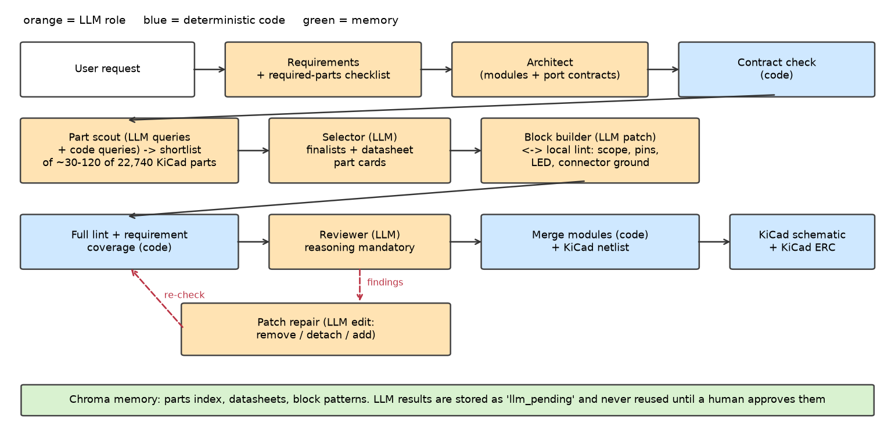
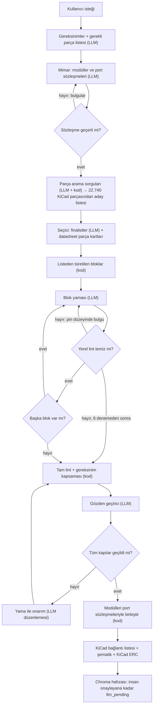
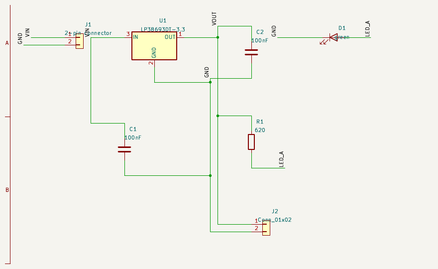
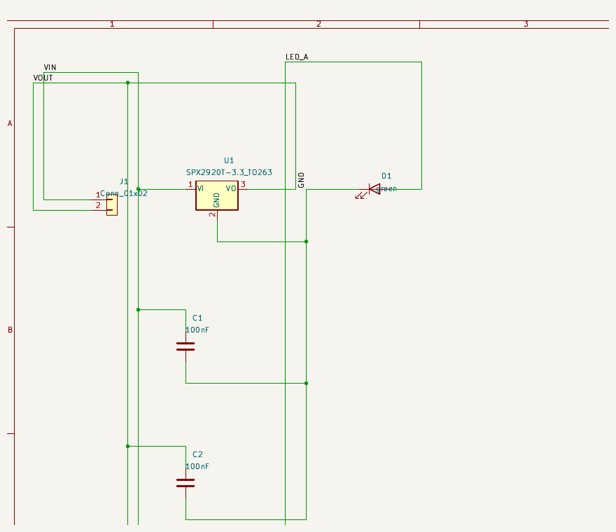

🇬🇧 [English](README.md) · 🇹🇷 Türkçe

# PcbCreator

**Küçük PCB şematiklerini blok blok tasarlayan, yerelde çalışan, çok ajanlı bir LLM sistemi. Sonucu deterministik bir linter ve KiCad'in kendisi denetler.**

Model problemi bir bütün olarak görmez: gereksinim kontrol listesi işlevsel bloklara çevrilir, her blok küçük bir yama olarak eklenir ve hemen denetlenir, sonuç gerçek bir KiCad şematiği olarak çizilir. Her şey yerelde çalışır (8 GB'lık bir ekran kartında nicemlenmiş 27B model). Projenin hedefi (TÜBİTAK 2209-A): LLM'in tasarladığı alt kartların uçuş kontrolcüsü gibi daha büyük kartlarda birleştirilmesi, ilk aşamada da birkaç basit kartın gerçekten üretilmesi.


*Yerel modelin tasarladığı, KiCad'in çizdiği 5 V → 3.3 V LDO kartı ve güç LED'i (`assets/demo.png`). Kapılarımızdan geçiyor ama **üretime hazır değil**, bkz. Seçilmiş sonuçlar.*

## Özet

| Problem | Yöntem | Donanım / araçlar | Makale |
|---|---|---|---|
| Tek seferde LLM şematik üretimi, makul görünen ama elektriksel olarak yanlış ya da isteği yok sayan tasarımlar çıkarıyor | Gereksinim listesinden adım adım blok kurma, 22.740 KiCad parçasından aday listesi, datasheet parça kartları, blok başına yerel lint, yama tabanlı onarım, LLM gözden geçirici, KiCad ERC | RTX 5060 8 GB üzerinde Ternary Bonsai 27B (PrismML llama.cpp çatalı), KiCad 10.0.7, Chroma | [`paper/yontem.pdf`](paper/yontem.pdf) (yöntem raporu) |

### Sistem mimarisi



Turuncu kutular LLM rolleri, mavi kutular deterministik koddur. Her LLM çıktısı ilerlemeden önce deterministik bir kapıdan geçer, ve LLM sonuçları bir insan onaylayana kadar örnek olarak yeniden kullanılmaz.

### Akış şeması (nasıl çalışır)



## Seçilmiş sonuçlar

Tüm sonuçlar, tek bir geliştirme isteği (5 V → 3.3 V LDO kartı, yeşil LED ve iki 2 pinli konnektör) üzerinde, deterministik olmayan yerel bir modelin tek çalıştırmalarıdır. Hattın ne yaptığını gösterir, bir kıyaslama değildir. Ayrı bir test seti hâlâ TODO.

### Sonuç 1: tüm kapılardan geçen ilk LLM tasarımı
Dört blok (regülatör, LED, iki konnektör) ilk denemede kabul edildi, modül tam lint'ten, gereksinim kapsama kontrolünden ve gözden geçiriciden geçti, KiCad dosyayı açıp çiziyor (`plots/sonuc_1.png`). Parçanın datasheet'ini elle kontrol edince **değerlerinin hâlâ yanlış olduğu** görülüyor: giriş ve çıkış kondansatörleri 100 nF, oysa TI LP38693 datasheet'i giriş için 1 µF ve çıkış için en az 1 µF seramik istiyor. Datasheet parça kartı bu gereksinimi taşımıyordu (datasheet'in yalnızca ilk 12 sayfası okunuyordu), bu düzeltiliyor.



### Sonuç 2: linter'dan ve gözden geçiriciden geçti ama yanlış
Daha önceki bir tasarım linter'ımızdan ve LLM gözden geçiriciden geçti, oysa iki 2 pinli konnektör de VIN/VOUT bağlanmış, toprak pini yoktu. Ancak çizilince anlaşıldı (`plots/sonuc_2.png`). Bu, E053 kuralını doğurdu (bir hattı taşıyan konnektörün toprak pini olmalı). LED'in doğrudan hatta bağlanması da aynı türden bir kaçaktı (E051 kuralı).



### Sonuç 3: gerçek çalıştırmalarda bulunan hata sınıfları ve artık neyin yakaladığı

| Yerel modelin hatası | Deterministik veya yapısal önlem |
|---|---|
| "Düşük dropout lineer" isteğine anahtarlamalı regülatör seçildi | KiCad kütüphane ailesine göre gereksinim kapsama kontrolü (E200) |
| LED hatta bağlandı, direnç paralel | LED seri direnç kuralı (E051) |
| Toprağı olmayan 2 pinli konnektörler | Konnektör dönüş yolu kuralı (E053) |
| LED bloğu iki kez kuruldu (direnç ayrı gereksinim olarak yazılmıştı) | `support` türü: destek parçalarının kendi bloğu olmaz |
| Regülatör bloğunun içine LED eklendi, sonraki bloklar çakıştı | Blok kapsam kuralı (E205); kirli blok onarıma devredilir |
| Tüm modülü yeniden yazdırmak çalışan parçaları bozdu | Yama tabanlı onarım (sil / ayır / ekle) |
| Yanlış tasarımlar hafızaya "doğrulanmış" diye yazıldı (iki kez) | LLM sonuçları `llm_pending` olarak saklanır ve onaylanana kadar aramalardan hariç tutulur |

*Şekiller `plots/` klasöründe, ilgili modül dosyaları `results/` klasöründe.*

## Kurulum

**Gereksinimler:** Linux, Python 3.11–3.13 ([uv](https://docs.astral.sh/uv/) önerilir), sembol/footprint kütüphaneleriyle KiCad 10 (`/usr/share/kicad`), poppler-utils (`pdftotext`, `pdftoppm`), 27B model için yaklaşık 8 GB VRAM ve 16 GB boş RAM (testler için gerekmez).

```bash
git clone https://github.com/GulogluHaktan/PcbCreator.git
cd PcbCreator
uv sync --extra dev            # veya: python -m venv .venv && . .venv/bin/activate && pip install -r requirements.txt && pip install -e .
python scripts/check_install.py
uv run pytest                  # 60 test, model gerekmez
```

**Yerel model (`pcbc design` için gerekir).** Ternary Bonsai 27B, PrismML'in llama.cpp çatalını ister (Ollama bu biçimi yükleyemez):

```bash
mkdir -p ~/llm/prism-llama ~/llm/models
gh release download prism-b10787-73bfe6c -R PrismML-Eng/llama.cpp \
   -p 'llama-prism-b10787-73bfe6c-bin-linux-cuda-13.3-x64.tar.gz' -D ~/llm/prism-llama
tar -xzf ~/llm/prism-llama/llama-prism-*.tar.gz -C ~/llm/prism-llama
curl -L -o ~/llm/models/Ternary-Bonsai-27B-PQ2_0.gguf \
   https://huggingface.co/prism-ml/Ternary-Bonsai-27B-gguf/resolve/main/Ternary-Bonsai-27B-PQ2_0.gguf
uv venv ~/llm/cudalibs --python 3.12 && uv pip install --python ~/llm/cudalibs/bin/python nvidia-cuda-runtime nvidia-cublas
```

## Kullanım

Model olmadan tasarımları denetleyebilir, birleştirebilir, dışa aktarabilir ve çizdirebilirsin:

```bash
uv run pcbc example --out examples                                  # elle yazılmış regresyon tasarımı (LLM çıktısı değil)
uv run pcbc lint examples/mcu.module.json [--strict]                # hatada çıkış kodu 1
uv run pcbc merge examples/flight_controller.design.json -o fc.net  # modülleri birleştir, kartı lint et, KiCad bağlantı listesi
uv run pcbc render results/ldo_board.module.json --out render       # gerçek KiCad şematiği + PDF + PNG + KiCad ERC
```

Yerel modelle:

```bash
uv run pcbc index-kicad --memory .pcbc/chroma     # bir kez: 22.740 KiCad parçasını indeksle (birkaç dakika)
uv run pcbc seed-blocks --memory .pcbc/chroma     # elle yazılmış genel blok kalıpları (origin=human)
scripts/serve.sh                                  # llama-server, http://127.0.0.1:8080 (yüklenmesi yaklaşık 1 dakika)
uv run pcbc design "Power board: input 5 V from a 2-pin connector, a fixed 3.3 V low-dropout linear regulator, a 2-pin 3.3 V output connector, and a green power-indicator LED on the 3.3 V rail with a suitable current-limiting resistor (about 2 mA)." \
   --kicad --name ldo_board --memory .pcbc/chroma --out out
```

*Beklenen çıktı* (model deterministik değildir, satırlar birebir aynı olmaz):

```
requirements: ok
module power: shortlist 30 ICs -> finalists ['Regulator_Linear:LP38693DT-3.3', ...]
block 1/4 [linear_regulator]: ok (attempt 1)
block 2/4 [led]: ok (attempt 1)
...
module power: ok (1 warnings)
merge: ok
schematic drawing: out/schematic/ldo_board.png
status: ok
```

Her deneme `out/trace/` altına yazılır (gereksinimler, aday listesi, seçim, her blok ve lint sonucu, gözden geçirici çıktısı). Betik indirmelerini engelleyen üreticilerin datasheet'lerini `.pcbc/chroma/datasheets_manual/<Kütüphane>__<Parça>.pdf` yoluna elle koyabilirsin. LLM sonuçları hafızada `llm_pending` olarak bekler; şematiği incele, sonra `pcbc pending` ve `pcbc approve <id>`.

## Sonuçları yeniden üret

| Şekil | Komut |
|---|---|
| `plots/sonuc_1.png` (Sonuç 1) | `uv run pcbc render results/ldo_board.module.json --out /tmp/r1` |
| `plots/sonuc_2.png` (Sonuç 2) | `uv run pcbc render results/lint_clean_but_wrong.module.json --out /tmp/r2` |
| `assets/architecture.png` | `python3 scripts/make_architecture.py` |
| `paper/yontem.pdf` | `python3 scripts/make_report.py` (google-chrome-stable gerekir) |
| Linter / birleştirme / adım adım / onarım davranışı | `uv run pytest` |

`results/` içindeki iki modül dosyası, gösterilen çalıştırmalardaki modelin çıktısıdır. `pcbc design`'ı yeniden çalıştırmak farklı (birebir aynı olmayan) tasarımlar verir, çünkü yerel model 0.3 sıcaklıkta örnekleme yapar.

## Proje yapısı

```
PcbCreator/
├── assets/        # README görselleri (demo şematik, mimari)
├── plots/         # sonuç şekilleri (üretilen tasarımların KiCad çizimleri)
├── results/       # yukarıda gösterilen tasarımların modül JSON dosyaları
├── paper/         # yontem.tex / yontem.pdf: yöntem raporu; scripts/make_report.py ile üretilir
├── scripts/       # serve.sh (yerel model), check_install.py, make_architecture.py
├── src/pcbcreator/
│   ├── models.py        # Module / Net / Port / Design (tüm LLM çıktısı doğrulanan JSON'dur, çalıştırılan kod değil)
│   ├── lint.py          # deterministik kural kümesi (E0xx hata, Wxxx uyarı)
│   ├── stepwise.py      # bloklar, yamalar, yerel lint, kapsam kuralı, yama ile onarım
│   ├── coverage.py      # parça ailesine göre gereksinim kapsaması
│   ├── merge.py         # port sözleşmeleriyle modül birleştirme
│   ├── agents.py        # LLM rolleri ve prompt'lar
│   ├── pipeline.py      # orkestrasyon
│   ├── kicad_import.py  # resmî KiCad sembol kütüphanelerinden parçalar
│   ├── datasheets.py, partcards.py   # datasheet RAG ve yapılandırılmış parça kartları
│   ├── memory.py, block_patterns.py  # Chroma hafızası, elle yazılmış blok kalıpları
│   ├── schematic.py, kicad.py        # KiCad şematik yazıcı + ERC, bağlantı listesi
│   └── cli.py           # pcbc komutu
├── tests/         # 60 test
├── requirements.txt
└── README.tr.md
```

## Atıf, lisans ve iletişim

```bibtex
@misc{pcbcreator2026,
  title  = {PcbCreator: stepwise, locally run LLM design of PCB schematics with deterministic and KiCad verification},
  author = {TODO: yazar listesi},
  year   = {2026},
  url    = {https://github.com/GulogluHaktan/PcbCreator}
}
```

Lisans: TODO (sahibi karar verecek). İletişim: [GulogluHaktan](https://github.com/GulogluHaktan) GitHub hesabı üzerinden.

**Güvenlik notu.** Üretilen şematikler taslaktır. Parça pinleri KiCad'den gelir ama elektriksel sınırları model önerir ve bir insan datasheet'i kontrol edene kadar doğrulanmış sayılmaz. Uzman incelemesi olmadan kart ürettirme.
